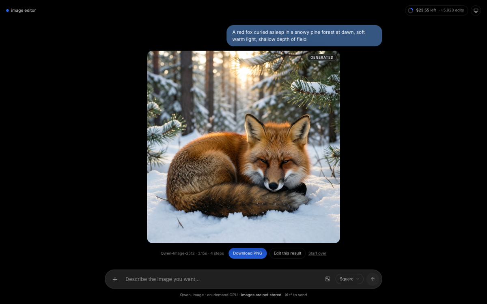
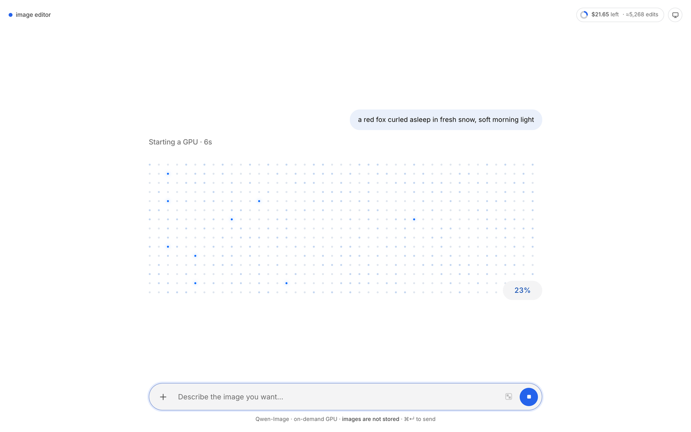
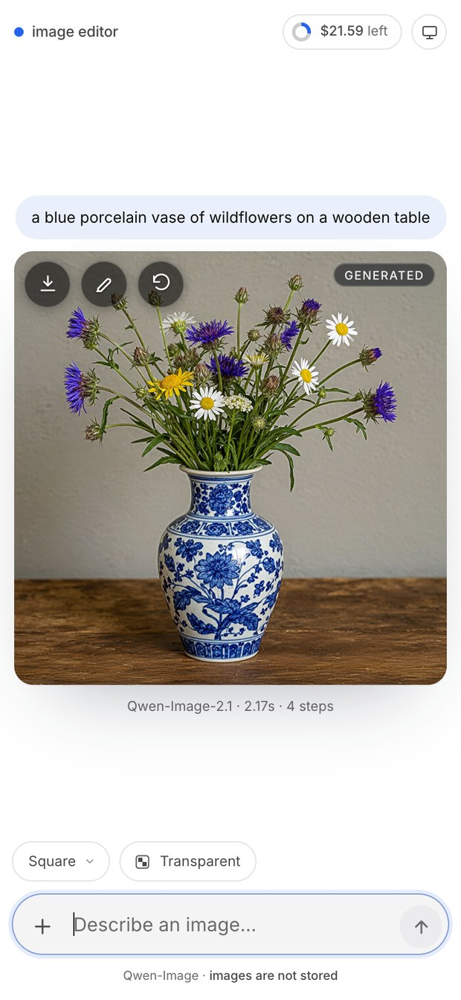
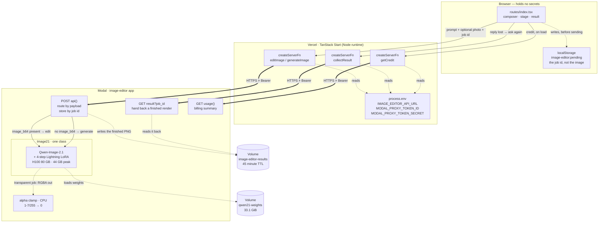
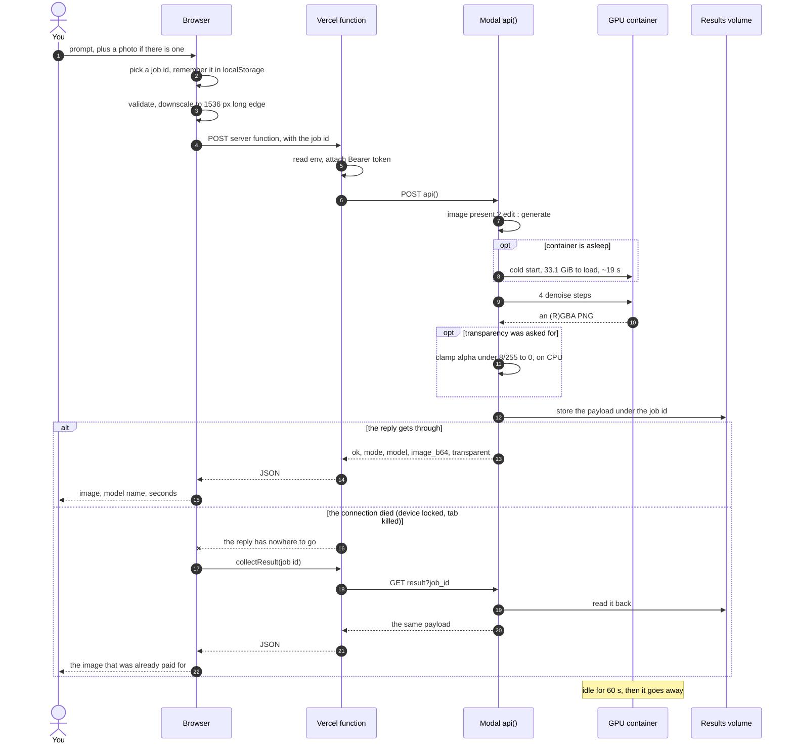

# image-editor

An image tool with two jobs and one rule: **a photo means edit, no photo means generate.**

- **Edit** — give it a photo and an instruction ("make it night time with warm street lights")
  and it returns the same photo, changed, with a wipe to compare before and after.
- **Generate** — give it only an instruction ("a lighthouse on a cliff at dusk") and it returns a
  new image, in a shape you pick.

Both run on demand on an H100 at [Modal](https://modal.com), behind a React app deployed to
Vercel. Nothing is stored anywhere. The whole thing is designed to survive on the $30/month
Modal Starter credit, which is the constraint that shaped most of the decisions below.

<p align="center">
  
</p>

---

## Screenshots

Every picture here is the real app on the live URL — no mockups.

<table>
  <tr>
    <td width="50%"><br><sub><b>Empty.</b> One composer, two ways in — type, or drop a photo.</sub></td>
    <td width="50%"><br><sub><b>Waiting.</b> A named phase, elapsed seconds, and dots capped at 92%.</sub></td>
  </tr>
</table>

<p align="center">
  <br>
  <sub><b>Result, desktop.</b> Prompt above, model and time beneath.</sub>
</p>

<p align="center">
  <br>
  <sub><b>Result, iPhone.</b> The actions ride on the picture, so a finished image does not push the composer down.</sub>
</p>

---

## Contents

1. [Screenshots](#screenshots)
2. [What a user sees](#what-a-user-sees)
3. [Architecture](#architecture)
4. [Request lifecycle](#request-lifecycle)
5. [The two models](#the-two-models)
6. [Repository layout](#repository-layout)
7. [The web app](#the-web-app)
8. [The Modal service](#the-modal-service)
9. [Cost model](#cost-model)
10. [Setup from zero](#setup-from-zero)
11. [Configuration reference](#configuration-reference)
12. [Verifying a deployment](#verifying-a-deployment)
13. [Troubleshooting](#troubleshooting)
14. [Known limits](#known-limits)
15. [Licence](#licence)

---

## What a user sees

| State | What is on screen |
|---|---|
| Empty | A headline, a drop target (the whole canvas), and a pill composer at the bottom |
| Photo attached | The photo centred, small thumbnails above the composer, seed control at the end of that row |
| Prompt only | The same composer, plus a shape picker — Square / Wide / Tall / Cinema |
| Running | The prompt as a right-aligned bubble, then a field of dots filling in behind a percentage |
| Done (edit) | Before/after wipe over the result, model name + seconds + steps underneath |
| Done (generate) | The generated image tagged `Generated`, same metadata row |
| Done, on a phone | The same, with download / edit / start-over as translucent icon buttons in the image's top-left corner instead of a row beneath it |
| Phone locked mid-render, then unlocked | The waiting state, then the render it was already owed — collected, not re-run |

The instruction is echoed as a chat bubble above the result, because the thing on screen is the
answer to the sentence you typed — and after a cold start of 40-plus seconds, being able to see
what you asked for is what tells you the wait was worth it.

The cutout is decided by the **prompt**, not by a switch. A prompt that says "transparent
background" — or cut-out, no background, remove the background, isolated on white, with alpha —
turns the cutout on by itself, and the footer says so before you send. The checkerboard icon in
the composer still overrides that for the session, and reloading returns to auto, so no stale
choice can quietly defeat a later prompt.

It applies to both jobs: a generated icon or a cut-out subject from a photo. When the result
really carries an alpha channel the stage draws a checkerboard behind it and the result row is
marked `transp.`, so transparency is visible rather than merely claimed.

---

## Architecture



Three endpoints, not one, and each earns its place: `api` does the work, `result` hands back
work that was already done, `usage` reads the bill. The second exists because a phone that locks
mid-render drops the reply while the GPU keeps going — see
[when the reply is lost](#when-the-reply-is-lost).

Three consequences of that shape, each deliberate:

**The browser never talks to Modal.** The endpoint URL and the proxy token live in the server
runtime (`process.env`, read *inside* the handler). Nothing is prefixed `VITE_`, because TanStack
Start inlines `VITE_`-prefixed values into client bundles — the single easiest way to hand a
credential to every visitor. No CORS config exists because no browser request ever reaches Modal.

**The GPU service serves no UI.** It answers JSON. An earlier version embedded a Gradio app,
which then needed its own password, its own secret, and its own failure modes; all of it was
deleted. The UI lives where it is cheap to serve and cheap to change.

**A render is addressable, because a reply can be lost.** Every request carries a job id the
client chose, and the finished image is stored under it before the response goes out. That costs
one small write and buys the only sane answer to a phone that locks mid-render: the work is
already paid for, so it is collectable rather than repeatable.

**One model, one container.** Qwen-Image-2.1 is a single 7 B model — 33.1 GiB in the Volume,
44 GB peak VRAM at the sizes this app serves — that both edits and generates. An earlier build
ran two checkpoints, Edit-2511 and 2512, because 53.7 GiB apiece against 80 GB of VRAM meant they
could not share a process; that cost a second cold start and a second 54 GiB load on every switch
between editing and generating. One class removes both, and `max_containers=1` caps the bill at
one H100 however many people use it at once.

The same simplification removed the matting step. The old checkpoints were RGB-only, so
"transparent background" was a *painted pattern*, and alpha had to be cut out afterwards by a CPU
container running a geometric key or u2net. 2.1 emits RGBA itself; what is left is a clamp.

---

## Request lifecycle



The client streams nothing and polls nothing while a render is running: one request, one
response, one image, and the progress UI is a client-side estimate (see
[the wait](#the-wait-is-an-estimate-not-a-feed)). The one exception is the recovery path — after
a reply is lost, the client asks for that job by id until it turns up or the budget runs out.

### The flow, in words

1. **You write a prompt and maybe drop a photo.** The composer decides what you are asking for by
   what is attached: a photo means *edit this*, nothing means *make this*. There is no mode
   selector to get wrong.
2. **The browser prepares the payload.** The photo is downscaled to a 1536 px long edge in a
   canvas before it leaves — a 12 MP phone photo is a slow upload and a larger tensor for no
   visible gain. The prompt is checked for length, and the transparency intent is read from it
   (see [transparency](#transparency-is-post-processing-not-generation)).
3. **It calls a server function, not Modal.** `lib/edit.ts` runs on Vercel, reads the endpoint URL
   and proxy token from `process.env` *inside* the handler, and makes the outbound request with a
   `Bearer` header. This is the whole point of the indirection: a credential in the browser bundle
   is a credential given away.
4. **Modal picks the job from the payload.** `image_b64` present routes to `Editor`, absent routes
   to `Painter`. One endpoint, so the client never contains routing logic that could disagree with
   the service.
5. **A cold container loads its weights first.** 54 GiB off the Volume takes 30–70 s; a warm one
   skips straight to the render. This is the only genuinely slow step, and it is why the UI shows
   elapsed time instead of pretending to measure progress.
6. **Four denoise steps, then a PNG.** At CFG 1.0 with the Lightning LoRA, four steps is the
   recipe the scheduler was distilled for. Typical denoise time is 3–4 s.
7. **The background is cut out if it was asked for,** on the CPU container, then the JSON comes
   back with `mode`, `model`, `transparent`, `seconds` and the image as base64.
8. **The page renders the answer** — image, the model that made it, the time, and whether it
   carries alpha — and the GPU container sits idle for 60 s before scaling to zero.

### When the reply is lost

Locking a phone mid-render kills the HTTP connection: iOS suspends the page and drops the socket.
The browser's `fetch` rejects and, before this existed, the page said *"Could not reach the
editor"* — while the GPU, which nobody told, finished the render and billed for it. The user paid
for an image they never saw, and retrying paid twice.

So the reply is not the only way to get the result:

- The client picks a **job id** with `crypto.randomUUID()` *before* sending, and writes it to
  `localStorage` as `image-editor:pending`. The image never goes there — ids are small, images are
  megabytes.
- `api()` writes the finished payload to the `image-editor-results` Volume under that id, before
  returning. The write is best-effort by design: failing to store must not turn a good render into
  an error.
- If the request throws or comes back marked `network`, the client **polls `result?job_id=`** —
  20 attempts, 3s apart — instead of re-rendering. Polling is the cheap half of the problem: it
  costs a CPU lookup, where a retry costs another H100 minute.
- A reload, a killed tab, or a crash recovers the same way: on mount the page finds the pending
  id, shows the waiting state, and asks for it.
- Results live for **45 minutes**, then `result` answers `expired` and the client says so rather
  than promising something that will never arrive. Starting over, succeeding, and expiring all
  clear the stored id.

One trap that cost a round of testing: the lookups travel the same broken path, and a server
function *rejects* in the browser on a dead network rather than returning `{ ok: false }`. Each
attempt is therefore guarded — one dead lookup is not a verdict.

---

## The model

| | |
|---|---|
| Checkpoint | `Qwen/Qwen-Image-2.1` — 7 B parameters, 32 single-stream DiT layers |
| Size in the Volume | 33.1 GiB (33.29 GB, 198 files, measured) |
| LoRA | `lightx2v/Qwen-Image-2.1-Lightning` — 4-step distillation, 64 MB bf16 |
| Jobs | generation **and** editing, from one set of weights |
| Steps at runtime | 4, always |
| Guidance | `true_cfg_scale=1.0` — guidance-free, which is how the distillation was trained |
| Alpha | native RGBA out; the background sits at 1-7/255 and is clamped to 0 |
| Output size | 1312², 1536×1024, 1024×1536, 1408×1056, 1056×1408, 1664×928, 928×1664 |
| Peak VRAM | 44.1 GB at 1312², 60.7 GB at 2048² (measured) |
| Speed | 3.2-3.8 s for 4 steps; 19.3 s to load the weights cold |
| Licence | Apache 2.0 |

All weights are downloaded once into a Modal Volume and read from there on every cold start. No
model file ever touches a developer machine, and there is no Hugging Face token because the repo
is not gated.

**Every output side is a multiple of 32.** The pipeline works on a 32-pixel latent grid and
*silently* snaps what it is given — 1328 came back as 1312 — so the request would disagree with
the reported size and the aspect would drift off its intended ratio. The buckets above are the
trained 1:1 / 3:2 / 4:3 / 16:9 shapes at roughly 1.5 MP rather than the card's 2048-px family:
the image still fills a phone's screen, and the PNG stays a couple of megabytes instead of six.

### The scheduler is the thing that decides good output from garbage

A Lightning LoRA is a distillation, and a distillation carries an implicit noise schedule. The
LoRA file does not contain it. The pipeline therefore gets a **rebuilt**
`FlowMatchEulerDiscreteScheduler` — exponential shifting, `base_shift=0.5`, `max_shift=0.9`,
`base_image_seq_len=256`, `max_image_seq_len=8192` — plus the four sigmas the distillation was
trained at, `[1.0, 0.75, 0.5, 0.25]`, passed per call.

Two details that are easy to get wrong, and both were verified against the published model rather
than guessed:

- **These are not the 2511 numbers.** The previous LoRA used `math.log(3)` for both shifts; 2.1
  uses `0.5` and `0.9`. Copying the old config across produces plausible-looking images with a
  faint grid.
- **The sigmas matter as much as the scheduler.** `num_inference_steps=4` alone lets the pipeline
  derive its own sigmas; passing the distilled ones is what makes four steps enough.

Attaching the LoRA to the pipeline's *default* scheduler is the mistake the Lightning repo
documents as grid artifacts. The config is a single constant (`LIGHTNING_SCHEDULER_CONFIG`),
applied in one place, and `check_env` builds it on a CPU container to prove it parses before any
GPU is rented.

---

## Repository layout

```text
image-editor/
├── web/                          TanStack Start app — deploy target: Vercel
│   ├── src/
│   │   ├── routes/
│   │   │   ├── __root.tsx        shell, theme script, error + 404 components
│   │   │   └── index.tsx         the studio: stage, composer, wait, result
│   │   ├── components/
│   │   │   ├── Header.tsx        chrome floated over the canvas
│   │   │   ├── CreditChip.tsx    remaining credit, top right
│   │   │   ├── ThemeToggle.tsx   light / dark / auto
│   │   │   └── Toaster.tsx       transient messages
│   │   ├── lib/
│   │   │   ├── edit.ts           the ONLY place that talks to Modal (server)
│   │   │   ├── credit.ts         credit server function (server)
│   │   │   ├── credit-store.ts   tiny external store + localStorage cache
│   │   │   └── toast.ts          external store for toasts
│   │   └── styles.css            design tokens (light + dark) and all component CSS
│   ├── vercel.json               framework: tanstack-start
│   └── .env.example              3 required variables, no VITE_ prefix
│
├── modal_app/
│   └── src/modal_app/
│       └── app.py                the GPU service: one class, three endpoints, helpers
│
├── scripts/edit.py               CLI client for the deployed endpoint
├── docs/COST.md                  the longer cost argument
└── pyproject.toml                uv workspace root
```

---

## The web app

### Routes

`__root.tsx` renders the HTML shell: a blocking theme script (so there is no light flash before
hydration), `Header`, and children. `index.tsx` is the entire studio — one route, because the
product is one screen.

### Server functions

`src/lib/edit.ts` is the only module that knows Modal exists. It exports three server functions:

```ts
editImage({ imagesBase64, prompt, steps, seed, jobId })      // requires 1–4 images
generateImage({ prompt, steps, seed, aspect, jobId })        // no images
collectResult({ jobId })                                     // what a lost reply owes you
```

Both validate their own inputs and share one transport (`callModal`). The transport reads
`IMAGE_EDITOR_API_URL`, `MODAL_PROXY_TOKEN_ID`, `MODAL_PROXY_TOKEN_SECRET` from `process.env`
inside the handler, posts JSON, and normalises failures into `{ ok: false, error }` so the UI
never has to parse a stack trace. It also checks `body.mode` against what it asked for: a
generate call that somehow came back as an edit is an error, not a result.

`collectResult` posts nothing to the model: it asks `GET result?job_id=` and answers with the same
`EditOutput` shape, plus `pending` (still running, ask again) and `expired` (aged out).

`src/lib/credit.ts` does the same for `GET usage` — deriving the usage URL from the API URL by
replacing `-api` with `-usage`, with `IMAGE_EDITOR_USAGE_URL` as an override. `collectResult`
derives `-result` the same way, with `IMAGE_EDITOR_RESULT_URL` as the override.

### State

One reducer-shaped `useState` set in `index.tsx`:

```text
idle ──prompt+photo──────────▶ running ──ok──▶ done ──"Edit this result"──▶ idle (photo = result)
  ▲      │                        │  │
  │      └─prompt only───────────▶│  └──error──▶ error ──"Try again"──▶ running
  │                               │
  └────────"Start over"───────────┴──"Stop waiting"──▶ done (if a result existed) or idle
```

`runId` is bumped on every new run and every cancellation, so a late response from an abandoned
request can never overwrite the screen — including the recovery poll, which gives up the moment the
user starts something else.

Besides the React state there is exactly one persisted fact: `localStorage['image-editor:pending']`,
the id (and prompt) of a render this device is still owed. It is what makes a reload after a lock
recover instead of forget.

### The wait is an estimate, not a feed

Modal does not stream progress, so `waitProgress(elapsed, warmed)` maps elapsed seconds onto a
percentage: three phases (`Starting a GPU`, `Loading the model`, then `Editing` or `Painting`),
capped at **92%**. The cap is deliberate — a bar that reaches 100% while the image has not
arrived is a lie, and the arrival of the image is the only real completion signal.

The dot field is 15 rows of as many columns as fit — 26 at desktop width, 24 on a 375px phone —
lit in a **fixed** pseudo-random order: a fixed shuffle looks
scattered while every tick keeps the same arrangement, where `Math.random()` per frame reads as
noise instead of progress.

### Images are downscaled in the browser

Phone photos are 8–12 MP; the model was trained around 1 MP, and Vercel caps request bodies near
4.5 MB which base64 pushes over fast. `prepareImage()` re-encodes through a canvas to a 1536 px
long edge before anything is uploaded — which also strips EXIF rotation problems, since
`createImageBitmap` honours orientation.

### Theming

One token block per theme in `styles.css` (`:root`/`.light` and `.dark`), no
`prefers-color-scheme` media query in CSS: the blocking script in `__root.tsx` resolves
`auto → light|dark` and puts the class on `<html>` before first paint, so CSS only ever sees a
resolved theme.

---

## The Modal service

`modal_app/src/modal_app/app.py` is the whole backend. Nothing else runs in Python.

| Object | Kind | GPU | Purpose |
|---|---|---|---|
| `api` | FastAPI endpoint (POST) | no | Routes by payload (photo → edit, none → generate), stores the result by job id |
| `result` | FastAPI endpoint (GET) | no | Hands a finished render back by job id — the lock-and-sleep path |
| `usage` | FastAPI endpoint (GET) | no | Remaining credit for the header chip |
| `Image21` | `@modal.cls` | H100 | `render(prompt, aspect, images?, transparent, seed)` — both jobs |
| `check_env` | function | no | Proves the dependency set loads before renting a GPU |
| `download_weights` | function | no | Checkpoint + LoRA into the Volume |
| `volume_stats` | function | no | What is actually in the Volume |
| `selftest` | local entrypoint | — | All three paths in one container |
| `smoke` / `smoke_generate` | local entrypoints | — | One real run each, no HTTP or auth in the way |

All three endpoints are `requires_proxy_auth=True`. The class is `max_containers=1`,
`scaledown_window=60`, `timeout=1200`.

### One endpoint, two jobs

```http
POST https://<workspace>--image-editor-api.modal.run
Authorization: Bearer <wk-id>.<ws-secret>
Content-Type: application/json

{ "prompt": "make it night", "image_b64": ["iVBOR..."], "steps": 4, "seed": 0 }
{ "prompt": "a lighthouse at dusk", "image_b64": [], "aspect": "16:9", "steps": 4, "seed": 0 }
```

```json
{
  "ok": true,
  "mode": "edit" | "generate",
  "model": "Qwen/Qwen-Image-2.1",
  "transparent": false,
  "image_b64": "iVBOR...",
  "seconds": 3.61,
  "steps": 4,
  "size": [1024, 1024]
}
```

`transparent` reflects what actually happened, not what was asked: if no usable alpha comes back
the field is `false` and the image is returned intact, because losing a render the user waited for
is worse than returning one without alpha.

The mode is decided by **whether `image_b64` arrived**, not by a flag. That keeps the rule in one
place: the client cannot ask for a generate while sending a photo, and the API function is the
only thing that has to branch.

Failures are JSON with `ok: false` and a one-line `error`, never an opaque 500 — the web app
distinguishes "your token is wrong" (HTTP 401 from proxy auth) from "the model failed" (200 with
`ok: false`) by shape alone.

### Transparency is generation, not post-processing

This is the difference the 2.1 migration bought. The old checkpoints were RGB: asked for a
"transparent background", they painted a **grey checkerboard** — the visual idiom they learned,
not an alpha channel — so alpha had to be cut out afterwards, on CPU, by a module with two
methods (a geometric key for flat art, a u2net matte for photos), a pixel of erosion to kill the
grey fringe, a curve to un-soften the mask, and 176 MB of extra weights in the container.

2.1 emits RGBA itself, when asked in the phrasing it was trained on:

```text
This is an RGBA image with transparency. {your prompt} The image has alpha channel
and the background is transparent.
```

The result is a real alpha channel, so what is left is arithmetic on one channel:

| Step | Why |
|---|---|
| `alpha < 8 → 0` | the background comes back at 1–7/255, not 0: invisible on screen, a colour fringe once composited |
| flatten onto white otherwise | the pipeline returns RGBA even when nobody asked, and the UI draws a checkerboard wherever alpha exists |

`_useful_alpha()` answers the honest question — did an alpha channel actually arrive — and the
`transparent` field reports that, not the request.

### Loading order

1. `QwenImage21Pipeline.from_pretrained(..., bf16)`,
2. `load_lora_weights(<lightning>, adapter_name="lightning")`,
3. **then** replace the scheduler with the distillation config,
4. `.to("cuda")`.

The LoRA goes on before the scheduler swap because `load_lora_weights` reads the pipeline's
existing scheduler config as its base; the order the Lightning reference uses. The load time is
logged (`2.1 + 4-step LoRA on GPU in Ns`) so the cold-start share of a bill is measurable rather
than remembered.

---

## Cost model

Modal bills per second of a live container. H100 SXM5 is **$0.001097/s** ($3.95/hr). Storage is
free inside the 1 TiB allowance, so neither Volume appears in the bill: the checkpoint is 33.1 GiB
and a stored render is 1–3 MB, pruned after 45 minutes. The recovery lookup itself is a
CPU container that never starts a GPU, which is the whole reason it is the cheap half of the
problem.

The important subtlety, and the one that makes naive estimates wrong: **the 60-second scaledown
window is billed.** Modal's own pricing FAQ says containers stay alive "for 60 seconds after the
last inputs before we shut them down, which we also bill for". So a single isolated edit costs
its load, its work, *and* a minute of idle H100 — about 6.6 cents of pure waiting. Batching is
not an optimisation, it is the difference between 286 edits a month and 3,300.

### Measured

| | Work | + idle tail | Cost, isolated |
|---|---|---|---|
| Render, warm | 3.2–3.8 s | 63–64 s | ~$0.070 |
| Render, cold | 19.3 s load + 3.7 s | 83 s | ~$0.091 |
| Edit and then generate | one cold start, both renders | 86 s | ~$0.095 |

Editing and generating now share a container, so switching between them no longer pays a second
cold start — the case that used to cost ~$0.15 and two 54 GiB loads costs one load and 3.7 s more.

The first inference on a freshly loaded container is slower than the steady state because of
kernel warm-up; the table quotes the steady state, and `selftest` reports what a first run really
takes.

### What $30/month buys

| Pattern | Renders |
|---|---|
| Every request isolated (cold start each) | ~329 |
| Batches of 5 in one sitting | ~1,395 |
| Batches of 20 in one sitting | ~3,540 |
| Marginal cost of one more, GPU already warm | **$0.0041 → ~7,330** |

One model halves the number of things that can be cold: there is no case where an edit warms one
container and a generate needs another. The header chip shows the last row — the optimistic bound,
because it assumes the GPU is already warm. The honest planning numbers are the batch rows. `docs/COST.md` carries the longer argument.

### What would blow the budget

| Lever | Effect |
|---|---|
| `max_containers` raised above 1 | N concurrent requests = N H100s at once |
| `scaledown_window` raised | Every idle minute after the last edit is billed |
| `min_containers` set | A permanently warm H100 is **$2,848/month** |
| Alternating edit ↔ generate | Each switch pays a full cold start once the other container has scaled down |
| A shared public link | No rate limit exists; the $30 is the only ceiling |

GPU memory snapshots are **not** used: Modal's docs state they "do not speed up model loading
from storage" and may worsen it, and for a 53.76 GiB checkpoint initialisation is entirely
storage-bound.

---

## Setup from zero

### 0. Prerequisites

- [`uv`](https://docs.astral.sh/uv/) (Python 3.12+), Node 20+, `pnpm`
- a Modal account (Starter includes $30/month of compute)
- a Vercel account for the web half

### 1. Authenticate and install

```sh
modal setup                      # opens the browser
uv sync --all-packages           # the uv workspace: modal_app
```

### 2. Prove the dependency set — on a CPU, for cents

```sh
uv run --package modal-app modal run modal_app/src/modal_app/app.py::check_env
```

This loads the processor, imports `peft`, checks that `diffusers` exports both pipeline classes,
and constructs the distillation scheduler. Everything it checks has failed at least once, and
every one of those failures only surfaced on a GPU. Run it before every deploy that touches the
image.

### 3. Pull the weights into the Volume (once, 33.1 GiB)

```sh
uv run --package modal-app modal run modal_app/src/modal_app/app.py::download_weights
uv run --package modal-app modal run modal_app/src/modal_app/app.py::volume_stats
```

One checkpoint plus its 64 MB LoRA. Storage is free under 1 TiB, so this costs $0/month.
`volume_stats` skips symlinks so it does not double-count a Hugging Face cache; the figure it
prints (33.1 GiB, 198 files) is the one to budget with.

Xet is disabled on this image (`HF_HUB_DISABLE_XET=1`) for a reason worth keeping: Hugging Face's
chunked transfer stalled at 28.2 of 33 GiB here and never resumed, while plain HTTP resumes,
retries, and reports progress. The final 5 GiB took seconds once it was off.

`download_weights` calls `commit()` on the Volume — without that the writes vanish when the
container exits and every cold start re-downloads everything.

### 4. Prove both models actually run

```sh
uv run --package modal-app modal run modal_app/src/modal_app/app.py::smoke \
    --prompt "make it snow" --image path/to/photo.jpg

uv run --package modal-app modal run modal_app/src/modal_app/app.py::smoke_generate \
    --prompt "a red fox in falling snow" --aspect 1:1
```

Outputs land in `outputs/`. Each run costs a cold start (~$0.10–0.15).

### 5. Deploy the GPU service

```sh
uv run --package modal-app modal deploy modal_app/src/modal_app/app.py
```

It prints both endpoint URLs:

```text
https://<workspace>--image-editor-api.modal.run     POST  (proxy auth)
https://<workspace>--image-editor-usage.modal.run   GET   (proxy auth)
```

### 6. Create a proxy token

```sh
modal workspace proxy-tokens create
```

You get a `wk-…` id and a `ws-…` secret. This is what keeps the endpoint private: without it the
URL is a public GPU.

### 7. Point the web app at it

```sh
cd web
pnpm install
cp .env.example .env      # then fill in the three values
pnpm dev                  # http://localhost:3000
```

```dotenv
IMAGE_EDITOR_API_URL=https://<workspace>--image-editor-api.modal.run
MODAL_PROXY_TOKEN_ID=wk-...
MODAL_PROXY_TOKEN_SECRET=ws-...
```

The names are not cosmetic. `MODAL_TOKEN_ID` / `MODAL_TOKEN_SECRET` are the **Modal CLI's** own
auth variables; these are **proxy** tokens for web-function auth. Exporting a proxy token under
the CLI's names breaks the CLI with `Token ID is malformed`.

**Never add a `VITE_` prefix.** TanStack Start inlines those into the browser bundle.

### 8. Deploy the web app

The Vercel project's **Root Directory is `web`**, so the deploy runs from the *repository root*:

```sh
pnpm dlx vercel deploy --prod      # from the repo root, not from web/
```

Running it from inside `web/` makes Vercel look for `web/web` and fail with
`The specified Root Directory "web" does not exist`. That is the single most likely deploy
failure, and it fails the same way whether it is typed by hand or copied from an older README.

Then set the three variables in **Vercel → Settings → Environment Variables** and redeploy.
`web/vercel.json` declares `framework: tanstack-start`; Vercel builds through Nitro. The Hobby
plan allows up to 300 s per function, which fits a cold start plus an edit.

Deployment **URLs** are protected by Vercel authentication (a fine default), but the production
**alias** is public — that is the link to share.

---

## Configuration reference

| Variable | Where | Required | What breaks without it |
|---|---|---|---|
| `IMAGE_EDITOR_API_URL` | Vercel env / `web/.env` | yes | `The editor is not available right now.` |
| `MODAL_PROXY_TOKEN_ID` | same | yes | same |
| `MODAL_PROXY_TOKEN_SECRET` | same | yes | same |
| `IMAGE_EDITOR_USAGE_URL` | optional | no | derived from the API URL by swapping `-api` → `-usage` |
| `IMAGE_EDITOR_RESULT_URL` | optional | no | derived from the API URL by swapping `-api` → `-result` |

Derivation assumes Modal's URL shape (`<workspace>--<app>-<function>.<region>.modal.run`), so it
follows the function name. Set the override if the app is ever renamed.

Model and runtime constants live in `app.py` and are meant to be edited there:

| Constant | Value | Meaning |
|---|---|---|
| `MODEL_ID` | Qwen/Qwen-Image-2.1 | the one checkpoint, for both jobs |
| `VOLUME_NAME` | qwen21-weights | where its 33.1 GiB lives |
| `DEFAULT_STEPS` | 4 | distilled path; anything else is ignored |
| `MAX_IMAGES` | 4 | reference images per edit (2.1 accepts 10; the cap is payload) |
| `ASPECTS` | 7 buckets, all multiples of 32 | what the pipeline can actually produce |
| `MAX_EDGE` (web) | 1536 px | client-side downscale before upload |
| `MAX_UPLOAD_BYTES` (web) | 20 MB | rejected before decode |
| `RESULTS_TTL_S` | 45 min | how long a finished render can be collected |

---

## Verifying a deployment

| Question | Command |
|---|---|
| Do the dependencies import and does the scheduler build? | `modal run …::check_env` |
| Is the Volume intact? | `modal run …::volume_stats` |
| Do all three paths work in one container? | `modal run …::selftest` |
| Does an edit produce a sane image? | `modal run …::smoke --image … --prompt …` |
| Does a generation? | `modal run …::smoke_generate --prompt …` |
| Does transparency really produce alpha? | `modal run …::smoke_generate --transparent true`, then check the PNG's mode |
| Can a finished render be collected by id? | `POST api` with a `job_id`, then `GET result?job_id=…` |
| Does an unknown id answer `pending`? | `GET result?job_id=never-sent` |
| Is the app that is deployed the code I just wrote? | `modal app list`, then compare deploy time |

`smoke`, `smoke_generate` and `selftest` call the **deployed** class through `modal.Cls.from_name`,
so they test the deployment, not the file on disk.

`selftest` is the one to run after a change: three renders (generate, generate with alpha, edit)
in a single container, so one cold start covers all three branches and any one of them breaking
is visible in one output.

---

## Troubleshooting

**A fix appears not to work.** `modal.Cls.from_name` resolves the *deployed* app, not your local
file, so after changing the image or a class you must `modal deploy` before a local smoke run can
see it. Skipping that makes a correct fix look broken while the deployed container crash-loops on
the old image.

**`ImportError: Qwen2VLVideoProcessor requires the Torchvision library`** — add `torchvision`.
**`ValueError: PEFT backend is required for load_lora_weights()`** — add `peft`. Both are the
same trap: nothing asks for them at import time, so the image builds clean and the failure lands
only on a GPU. `check_env` exists to catch exactly this for cents.

**`Unrecognized processing class in Qwen/Qwen-Image-2.1`** — a healthy model. Components live in
subfolders; the processor needs `subfolder="processor"`. `check_env` tries the subfolder and the
root, so it reports which one worked rather than crying wolf.

**Faint grid over an otherwise plausible image** — the LoRA is attached to a default scheduler.
Rebuild it with `LIGHTNING_SCHEDULER_CONFIG`.

**`The specified Root Directory "web" does not exist`** — the deploy was run from inside `web/`.
The project already has `web` as its Root Directory; run it from the repo root.

**A 401 from the web app** — the proxy token is wrong, not the model. The server logs Modal's
status and body so the two are distinguishable.

**`Could not reach the editor` after the phone was locked** — the client lost the reply, not the
render. It now polls `result?job_id=` for about a minute and shows the image if it lands; if the
render was slower than that, the render is still in the results Volume for 45 minutes but nothing
is chasing it. `localStorage['image-editor:pending']` still holds the id, so a reload retries the
collection once more.

**`That render expired`** — the entry was older than `RESULTS_TTL_S`. The store is a recovery
window, not storage; the image was never ours to keep.

**The editor answered something unexpected** — the mode guard fired: the request asked for a
generate and got an edit (or vice versa). Check that the payload still carries `image_b64: []`
for generations.

**A cold start slower than it should be may be a crash loop.** Containers that repeatedly fail to
start still bill. Check `modal app logs` before optimising anything.

**A checkerboard appears painted *into* the image.** That is the old failure, and it should not
happen any more: 2.1 writes a real alpha channel when asked in its trained phrasing, which
`_render` supplies. If a checkerboard is visible as pixels, the `transparent` flag never reached
the backend — check the request body in the server log.

**The reported image size is smaller than the one requested.** The pipeline snaps to a 32-pixel
grid: 1328 becomes 1312. `ASPECTS` is already on the grid, so this only appears if a size is
edited by hand.

**A first render takes ~25 s and ~4 s after.** The cold path is 19.3 s of weight loading plus the
render; both are logged (`2.1 + 4-step LoRA on GPU in Ns`), so the split is checkable in
`modal app logs` rather than guessed.

---

## Known limits

- **`max_containers=1` serialises requests.** Two visitors at once means the second
  waits with no feedback until Vercel's 300 s cap returns a 504 — while the GPU bills the queue.
- **Cancel is not cancel.** `Stop waiting` abandons the client-side promise. Modal cannot cancel
  a call already running, so the GPU finishes and bills anyway. The copy says so rather than
  pretending otherwise.
- **No rate limiting.** Anyone with the URL can spend the credit; the $30 is the only ceiling.
  A per-IP limit on the server function is the obvious next guard.
- **The credit chip is optimistic.** It estimates from the warm edit cost and ignores cold
  starts and the idle tail.
- **No history.** One result at a time, and `Start over` discards it on purpose. The result store
  is a recovery mechanism, not an album: entries expire after 45 minutes and are pruned on write.
- **Recovery has a budget.** A lost reply is chased for about a minute. If the render takes longer
  than that — a cold start plus a queue behind `max_containers=1` can — the user sees an error and
  the finished render expires unclaimed.

---

## Licence

Application code: do as you like. Model weights: **Apache 2.0** (Qwen), and the Lightning LoRAs
are **Apache 2.0** (LightX2V). Neither repo is gated, so no Hugging Face token is needed.
